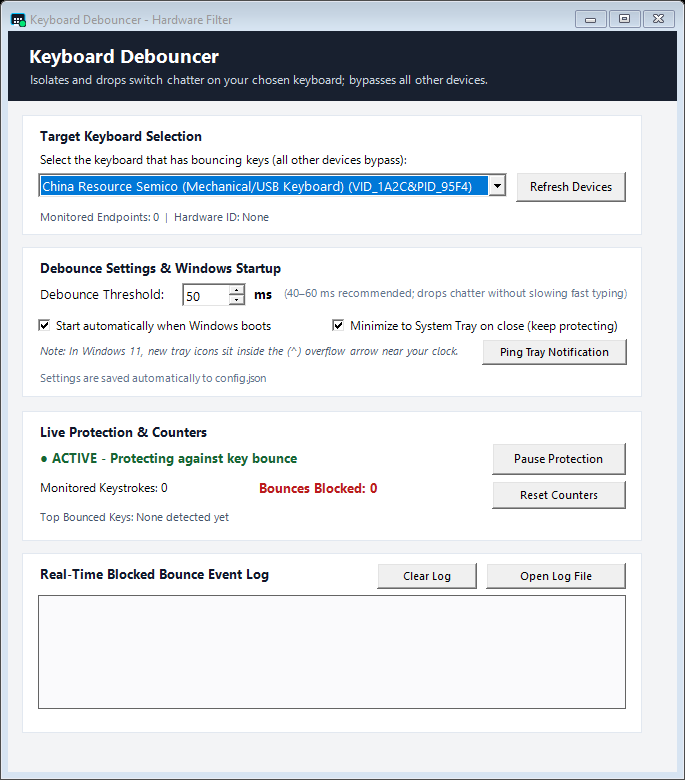

# Keyboard Debouncer (Hardware Filter)

[](https://microsoft.com/windows)
[](https://dotnet.microsoft.com/)
[](https://docs.microsoft.com/en-us/dotnet/csharp/)
[](LICENSE)

A high-performance, native Windows utility that **filters out mechanical switch bounce (key chatter) exclusively on your chosen keyboard** while **completely bypassing all other input devices** (secondary keyboards, mice, macro pads, game controllers, and software-injected keystrokes).



---

## 🎯 The Problem

Mechanical keyboard switches can develop physical contact bounce (chatter) due to oxidation, dust, or worn leaf springs. When a key is pressed or released, the switch contacts may rapidly make and break connection within a few milliseconds, sending duplicate keystrokes (e.g., `lloooking` instead of `looking`).

Most software debounce tools suffer from major drawbacks:
1. **Global Interception**: They debounce *every* input device connected to the PC, causing dropped inputs on game controllers, macro pads, mice, or secondary keyboards.
2. **Blocked Virtual Keys**: They break macros, AutoHotkey scripts, remote desktop clients, and accessibility tools by intercepting injected keystrokes.
3. **High Resource Usage & Lag**: Many require heavy background runtimes or introduce perceptible typing latency.

---

## 🚀 Key Features

- **Hardware-Specific Isolation via Win32 Raw Input (`WM_INPUT`)**:
  - Automatically identifies physical keyboards by their USB Vendor ID & Product ID (e.g., `VID_1A2C&PID_95F4`).
  - Only the selected keyboard has its switch chatter blocked.
  - Secondary keyboards, mice, gamepads, and virtual/injected inputs (`LLKHF_INJECTED`) bypass the filter untouched.
- **Interactive Device Selector**:
  - Automatically enumerates all connected physical keyboards and display human-friendly vendor names.
  - Select your specific keyboard or choose `[All Connected Keyboards]`.
- **System Tray Integration**:
  - Runs quietly in the Windows notification area with a custom high-contrast icon.
  - Minimizing (`_`) or closing (`X`) folds the window down to the System Tray to keep your keys protected in the background.
  - Right-click tray menu provides quick access to *Open*, *Pause/Resume*, and *Exit*.
- **Start with Windows**:
  - Built-in one-click toggle to launch automatically on Windows boot (starts directly minimized in tray via `--minimized`).
- **Live Diagnostics & Event Log**:
  - Real-time counters showing total keystrokes monitored and chatter bounces blocked.
  - Identifies top bouncing keys and logs every blocked bounce with millisecond timestamps and intervals.
- **Typematic Repeat Preservation**:
  - Distinguishes between switch bounce (< 50ms) and intentional key repeats (typematic rate >= 250ms). Holding down a key repeats normally.
- **Zero External Dependencies**:
  - Compiles directly with Windows' built-in .NET Framework C# compiler (`csc.exe`). No Visual Studio or runtime installations required.

---

## 🛠️ How It Works (Architecture)

```
[ Physical Keystroke ]
         │
         ├──► Win32 Raw Input (WM_INPUT on hidden sink window)
         │       └─► Extracts hardware device handle (hDevice)
         │       └─► Matches against target USB VID/PID
         │
         └──► Low-Level Hook (WH_KEYBOARD_LL)
                 ├─► If NOT from target keyboard ──► PASS THROUGH (0 ms latency)
                 ├─► If injected / virtual key   ──► PASS THROUGH
                 ├─► If Make/Break bounce (< 50ms)─► BLOCKED (Drops duplicate chatter)
                 └─► If valid keystroke          ──► PASS THROUGH
```

1. **Attribution**: Windows' `WH_KEYBOARD_LL` hook can block keystrokes globally, but lacks hardware device information (`hDevice`).
2. **Correlation**: `WM_INPUT` receives low-level hardware packets containing `hDevice`, but cannot block global window messages.
3. **Debounce Engine**: By pairing `WM_INPUT` on a dedicated message-only window with `WH_KEYBOARD_LL`, the engine accurately attributes every virtual key event to its physical USB device and filters chatter in under 1 millisecond.

---

## 📦 How to Build

No Visual Studio or SDK required! Every modern Windows installation (Windows 10 / 11) includes the C# compiler:

### Option 1: Double-click `build.bat`
Run the included `build.bat` script:
```cmd
build.bat
```

### Option 2: Command Line
Open PowerShell or Command Prompt in the repository folder:
```powershell
& "C:\Windows\Microsoft.NET\Framework64\v4.0.30319\csc.exe" /nologo /target:winexe /optimize+ /win32icon:app.ico /out:KeyboardDebouncer.exe /r:System.dll /r:System.Windows.Forms.dll /r:System.Drawing.dll /r:System.Core.dll KeyboardDebouncer.cs
```

This compiles a standalone ~40 KB executable (`KeyboardDebouncer.exe`).

---

## 💻 Usage

### Running the GUI
Double-click `KeyboardDebouncer.exe` to open the control panel.
- Select your target keyboard from the dropdown.
- Adjust the debounce threshold (default: **50 ms**; 40–60 ms is recommended).
- Check **Start automatically when Windows boots** to keep protection active across reboots.

### Command-Line Arguments
```cmd
:: Start directly minimized to the System Tray (used by Windows Startup)
KeyboardDebouncer.exe --minimized

:: Override target keyboard device filter
KeyboardDebouncer.exe --device VID_1A2C&PID_95F4

:: Set custom debounce threshold in milliseconds
KeyboardDebouncer.exe --debounce 50
```

---

## 🐍 Python Prototype

A standalone Python prototype is also provided in `keyboard_debounce.py`. It implements the same Win32 Raw Input + LL Hook correlation using Python's standard `ctypes` library (requires no pip packages):
```bash
python keyboard_debounce.py
```

---

## 📄 License

This project is open-source under the [MIT License](LICENSE).
